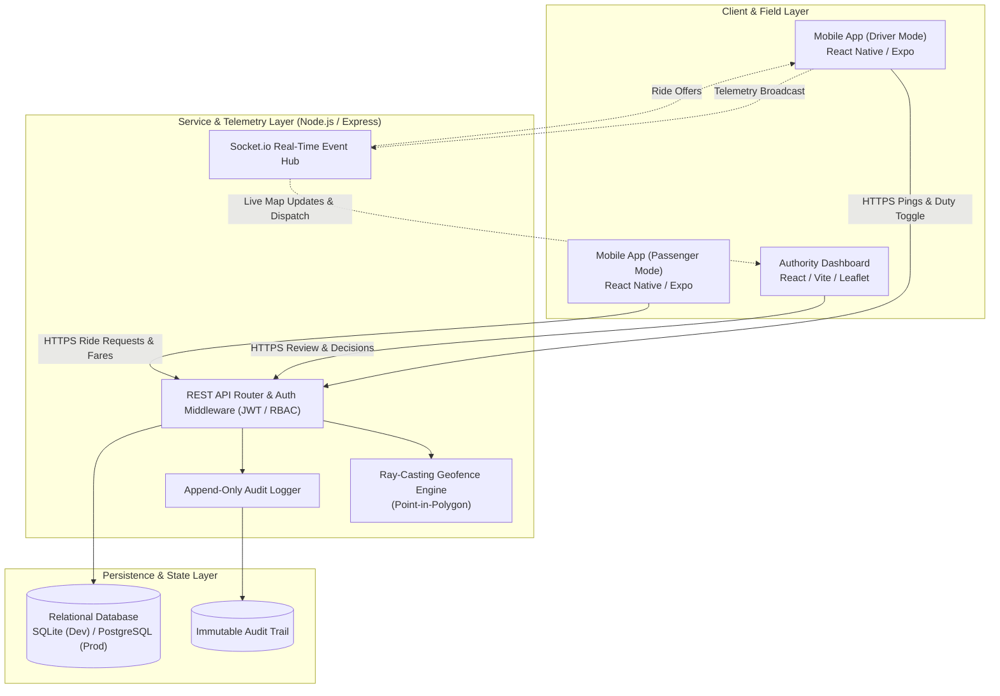
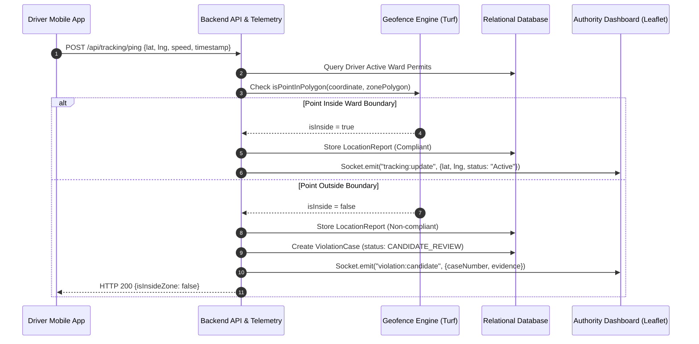
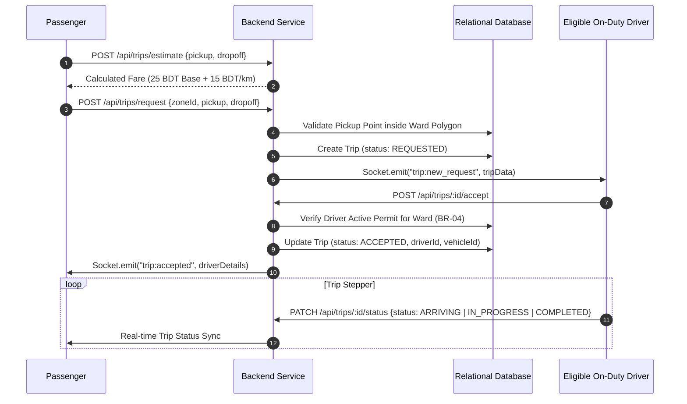
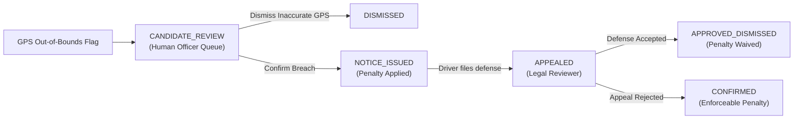

# E-RikshaNet — System Architecture & Workflow Specification

Version 1.0 · October 2026

---

## 1. System Topology Overview

E-RikshaNet is structured as a decoupled tri-tier system designed for regulatory compliance, real-time geofencing, and local ride dispatch within designated municipal wards in Bangladesh.

---

## 2. Core Operational Workflows

### 2.1 Live GPS Telemetry & Geofence Candidate Breach Pipeline
In accordance with **PRD Section 4.C and Business Rule BR-06**, GPS points reported outside ward boundaries **do not trigger automatic fines**. Instead, they generate reviewable candidate cases (`CANDIDATE_REVIEW`) for human officer verification.

---

### 2.2 Passenger Ride Dispatch & Eligibility Gating (BR-02, BR-04)
A driver cannot be matched or accept passenger rides unless they hold an **ACTIVE**, approved permit for the specific ward.

---

### 2.3 Violation Notice, Driver Appeal, and Independent Ruling (BR-07, BR-11)

---

## 3. Subsystem Breakdown

### 3.1 Backend Service (`server/`)
- **Runtime**: Node.js v22 (ESM) with TypeScript
- **Framework**: Express.js with Socket.io real-time clustering
- **ORM & Database**: Prisma ORM with SQLite for zero-dependency local runs and PostgreSQL compatibility for VPS production.
- **Security & Authorization**:
  - JWT Bearer tokens with strict server-side Role-Based Access Control (RBAC).
  - Centralized error-handling and input validation via Zod schemas.
  - Append-only audit logger writing to `AuditLog` table for all regulatory events.

### 3.2 Authority Dashboard (`web-admin/`)
- **Framework**: React 18, Vite, TypeScript, Tailwind CSS
- **Mapping**: Leaflet + `react-leaflet` rendering OpenStreetMap tiles, ward boundary polygons, and live vehicle markers with fresh vs. stale (>2 min) visual indicators.
- **Workflow Panels**:
  - *Live Fleet Monitor*: Visualized boundary compliance and vehicle details.
  - *Permit Review*: Multi-day validity assignments and mandatory justification notes.
  - *Registration Registry*: NID verification and chassis/battery compliance checks.
  - *Violations & Appeals*: Dual-tier human adjudication system (Enforcement Officer vs. Appeals Reviewer).
  - *Audit Trail*: Searchable regulatory ledger.

### 3.3 Standalone Mobile Applications

The mobile tier is split into two dedicated, role-specific applications sharing the central REST and WebSocket backend:

#### 🛺 E-RikshaNet Driver Partner (`mobile-driver/` - Port 8081)
- **Framework**: React Native with Expo SDK 51 and TypeScript (`com.erikshanet.driver`).
- **Full-Screen Street Navigation Map**: Embedded CartoDB Voyager street tile map rendering road vectors, driver location, and pickup target markers.
- **Operating Eligibility Gating**: Server validates active operating permit before allowing transition to `ONLINE`.
- **Hardware Telemetry Loop**: Automatic 8-second GPS telemetry loop (`expo-location`) broadcasting coordinates and speed to `/api/tracking/ping`.
- **Instant Dispatch Offer Drawer**: Real-time Socket.io push (`trip:new_request` on `zone:${zoneId}`) displaying upfront fare, pickup distance, and rider details.
- **Trip Execution HUD**: Turn-by-turn guidance header and progressive status progression (`ARRIVING` ➔ `IN_PROGRESS` ➔ `COMPLETED`).
- **Due-Process Appeals Interface**: File statements of defense against enforcement citations directly to the Appeals Reviewer.

#### 👤 E-RikshaNet Rider (`mobile-passenger/` - Port 8082)
- **Framework**: React Native with Expo SDK 51 and TypeScript (`com.erikshanet.passenger`).
- **Full-Screen Route Map**: Dynamic street map with pickup pin 🟢, destination pin 🏁, route line, and nearby active rickshaws.
- **Minimalist Transit Booking**: Fast destination chips (*Mirpur-10, Mirpur-11, Sec-7 Center, Pallabi Mkt*).
- **Deterministic Fare Formula (BR-12)**: Upfront calculation (Base 25 BDT + 15 BDT/km) previewed prior to booking.
- **Real-Time Driver Matching**: Sockets listen on `passenger:${id}` and `trip:${id}` to display assigned driver name, rating (★ 4.9), phone, and vehicle registration number without polling.
