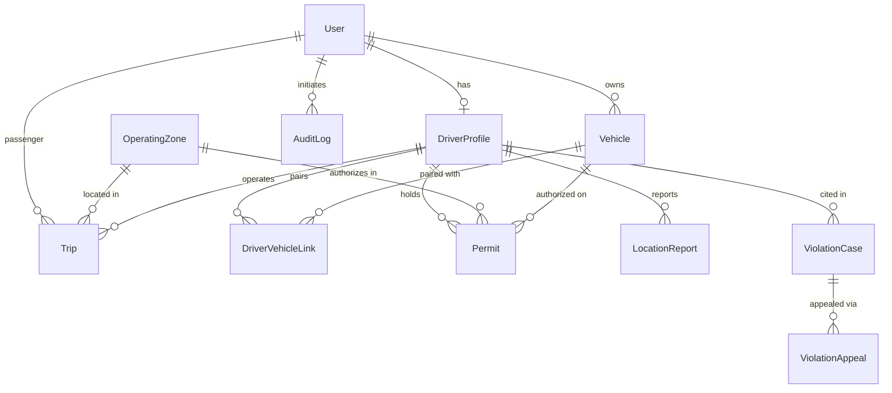

# E-RikshaNet — Database Schema Specification

---

## 1. Entity-Relationship Diagram

---

## 2. Relational Table Specifications

### 2.1 `User`
Stores system accounts, roles, and credential hashes.
- `id` (UUID, Primary Key)
- `phone` (VARCHAR, Unique, Indexed)
- `name` (VARCHAR)
- `email` (VARCHAR, Unique, Nullable)
- `passwordHash` (VARCHAR, bcrypt hash)
- `role` (VARCHAR: `PASSENGER`, `DRIVER`, `OWNER`, `REGISTRATION_REVIEWER`, `PERMIT_OFFICER`, `ENFORCEMENT_OFFICER`, `APPEALS_REVIEWER`, `ADMIN`)
- `status` (VARCHAR: `ACTIVE`, `SUSPENDED`)
- `createdAt`, `updatedAt` (TIMESTAMP)

### 2.2 `DriverProfile`
Regulatory identity and on-duty tracking state for drivers.
- `id` (UUID, Primary Key)
- `userId` (UUID, Unique, Foreign Key -> `User.id`)
- `nidNumber` (VARCHAR, Unique, National Identity Card Number)
- `licenseNumber` (VARCHAR, Nullable)
- `emergencyContact` (VARCHAR, Nullable)
- `status` (VARCHAR: `DRAFT`, `SUBMITTED`, `UNDER_REVIEW`, `APPROVED`, `REJECTED`, `CHANGES_REQUESTED`)
- `reviewNotes` (TEXT, Nullable)
- `isOnDuty` (BOOLEAN, Default `false`)
- `lastLatitude`, `lastLongitude` (FLOAT, Nullable)
- `lastPingAt` (TIMESTAMP, Nullable)
- `currentVehicleId` (UUID, Nullable)

### 2.3 `Vehicle`
Physical electric rickshaw specifications and ownership records.
- `id` (UUID, Primary Key)
- `registrationNumber` (VARCHAR, Unique, License plate / Municipal token)
- `chassisNumber` (VARCHAR, Unique)
- `model` (VARCHAR, e.g., "Walton E-Riksha Eco 1000W")
- `batteryCapacityKwh` (FLOAT, Nullable)
- `ownerId` (UUID, Foreign Key -> `User.id`)
- `status` (VARCHAR: `SUBMITTED`, `APPROVED`, `REJECTED`, `CHANGES_REQUESTED`)
- `reviewNotes` (TEXT, Nullable)

### 2.4 `DriverVehicleLink`
Many-to-Many join table linking authorized drivers to specific vehicles.
- `id` (UUID, Primary Key)
- `driverId` (UUID, Foreign Key -> `DriverProfile.id`)
- `vehicleId` (UUID, Foreign Key -> `Vehicle.id`)
- `isPrimary` (BOOLEAN, Default `false`)
- **Constraint**: `UNIQUE(driverId, vehicleId)`

### 2.5 `OperatingZone`
Geographical ward polygons and speed/capacity boundaries.
- `id` (VARCHAR, Primary Key, e.g., "zone-dhaka-ward-7")
- `name` (VARCHAR, e.g., "Mirpur Ward 7 Pilot Zone")
- `city` (VARCHAR, Default "Dhaka")
- `wardNumber` (VARCHAR)
- `polygonGeoJson` (TEXT, Coordinate array `[[lng, lat], ...]`)
- `speedLimitKmh` (FLOAT, Default 25.0)
- `maxPermittedVehicles` (INTEGER, Default 500)
- `isActive` (BOOLEAN, Default `true`)

### 2.6 `Permit`
Official operating permits issued by authorized officers for specific zones.
- `id` (UUID, Primary Key)
- `permitNumber` (VARCHAR, Unique, e.g., "PRM-MIRPUR-001")
- `driverId` (UUID, Foreign Key -> `DriverProfile.id`)
- `vehicleId` (UUID, Foreign Key -> `Vehicle.id`)
- `zoneId` (VARCHAR, Foreign Key -> `OperatingZone.id`)
- `status` (VARCHAR: `PENDING`, `ACTIVE`, `EXPIRED`, `SUSPENDED`, `REVOKED`)
- `effectiveDate` (TIMESTAMP, Nullable)
- `expiryDate` (TIMESTAMP, Nullable)
- `issuedById` (UUID, Foreign Key -> `User.id`)
- `decisionNotes` (TEXT, Mandatory for officer audit trail)

### 2.7 `LocationReport`
High-frequency GPS breadcrumbs ingested from on-duty driver devices.
- `id` (UUID, Primary Key)
- `driverId` (UUID, Foreign Key -> `DriverProfile.id`)
- `vehicleId` (UUID, Nullable)
- `latitude`, `longitude` (FLOAT)
- `accuracyMeters`, `speedKmh`, `heading` (FLOAT, Nullable)
- `isInsideZone` (BOOLEAN, Evaluated via ray-casting)
- `recordedAt` (TIMESTAMP, Device time)
- `serverReceivedAt` (TIMESTAMP, Ingestion time)
- **Index**: `INDEX(driverId, recordedAt)`

### 2.8 `ViolationCase` & `ViolationAppeal`
Regulatory citation records and defense submissions.
- `ViolationCase`:
  - `id` (UUID), `caseNumber` (VARCHAR, Unique)
  - `driverId`, `vehicleId`, `zoneId`
  - `category` (`GEOFENCE_BREACH`, `NO_VALID_PERMIT`, `SPEEDING`, etc.)
  - `evidenceJson` (TEXT, GPS coordinates and timestamp breadcrumbs)
  - `status` (`CANDIDATE_REVIEW`, `DISMISSED`, `NOTICE_ISSUED`, `APPEALED`, `CONFIRMED`, `RESOLVED`)
  - `officerNotes`, `penaltyAmount`, `issuedById`
- `ViolationAppeal`:
  - `id` (UUID), `caseId`, `driverId`
  - `reason` (TEXT), `evidenceJson` (TEXT, Nullable)
  - `status` (`PENDING`, `APPROVED_DISMISSED`, `REJECTED`)
  - `reviewerId`, `reviewerNotes`, `resolvedAt`

### 2.9 `Trip`
Passenger ride bookings, fare calculations, and dispatch states.
- `id` (UUID), `tripNumber` (VARCHAR, Unique)
- `passengerId`, `driverId`, `vehicleId`, `zoneId`
- `pickupLat`, `pickupLng`, `pickupAddress`
- `dropoffLat`, `dropoffLng`, `dropoffAddress`
- `estimatedFare` (FLOAT), `finalFare` (FLOAT, Nullable)
- `status` (`REQUESTED`, `ACCEPTED`, `ARRIVING`, `IN_PROGRESS`, `COMPLETED`, `CANCELLED`)
- `startedAt`, `completedAt`

### 2.10 `AuditLog`
Append-only regulatory audit ledger.
- `id` (UUID, Primary Key)
- `userId` (UUID, Nullable), `userRole` (VARCHAR, Nullable)
- `action` (VARCHAR, e.g., `PERMIT_STATUS_ACTIVE`, `VIOLATION_CASE_NOTICE_ISSUED`)
- `entityType`, `entityId`
- `details` (TEXT, JSON string)
- `ipAddress` (VARCHAR, Nullable)
- `createdAt` (TIMESTAMP, Default `now()`)
